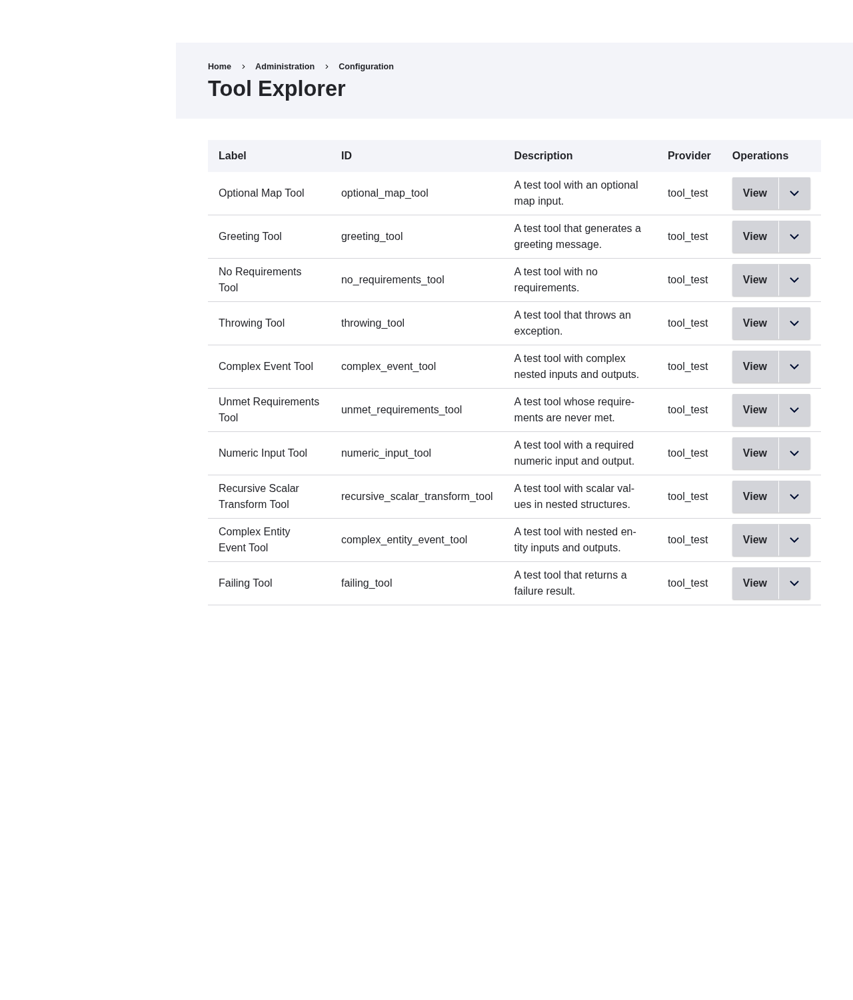
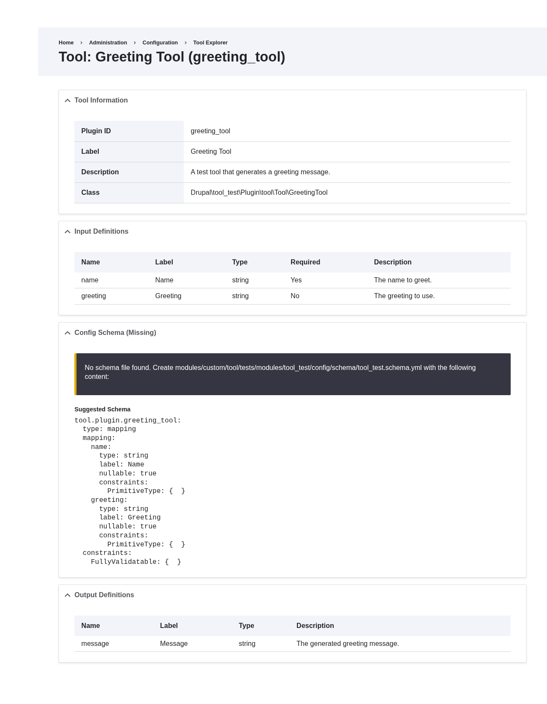
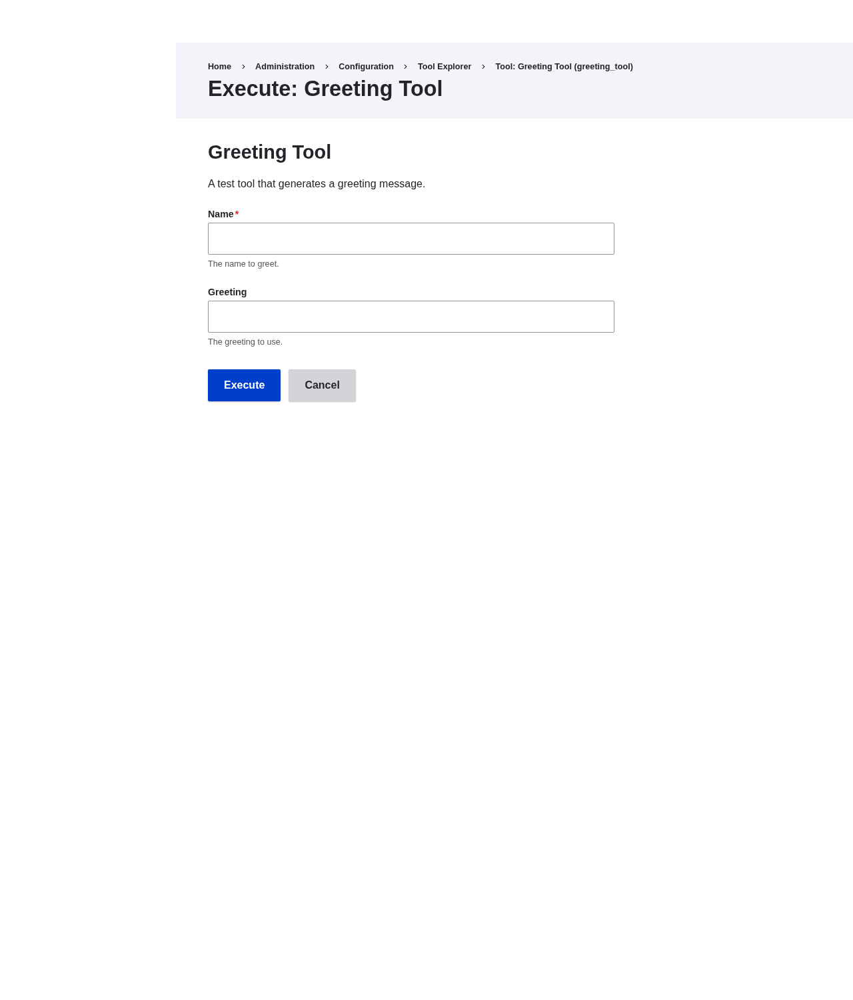

# Tool Explorer

Tool Explorer is a submodule that adds an admin UI for browsing and executing the
tools registered on your site. It is useful for confirming that a tool is discovered,
reading its inputs and outputs, checking its config schema, and running it by hand.

Enable it with:

```bash
drush en tool_explorer
```

Browsing requires the `view tool information` or `administer tool` permission,
and the Execute operation requires `administer tool`. The UI lives at
**Configuration > Development > Tool Explorer**
(`/admin/config/tool/explorer`).

## Tool list

The landing page lists every registered tool with its label, plugin ID, description,
and the module that provides it. Each row has a View operation, and an Execute
operation for users with `administer tool`.



## Tool details

The View page shows the full definition of a single tool:

- **Tool Information**: plugin ID, label, description, implementing class, and
  declared permission.
- **Input Definitions**: each input's name, label, data type, whether it is required,
  and its description.
- **Output Definitions**: each output's name, label, data type, and description.
- **Config Schema**: whether a `tool.plugin.<id>` config schema exists for the tool.
  When it is missing, the page prints a suggested schema you can paste into the
  provider module's `config/schema` file.



## Executing a tool

The Execute page renders a form built from the tool's input definitions, with
required fields marked and descriptions shown as help text. Submit the form to run
the tool as the current user. The tool's own access check still applies: a tool
that denies the current user reports the denial instead of running.



!!! note
    The Execute form reports whether execution succeeded or failed, but it does not
    print output values. Output can contain data the current user is not allowed to
    see (for example, fields on an entity they can view only partially), so the UI
    withholds it. Use [`drush tool:run`](drush.md) when you need to inspect returned
    values.
